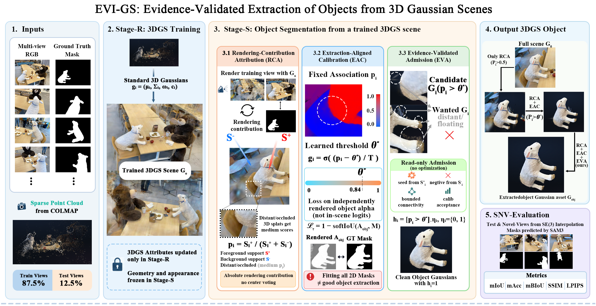
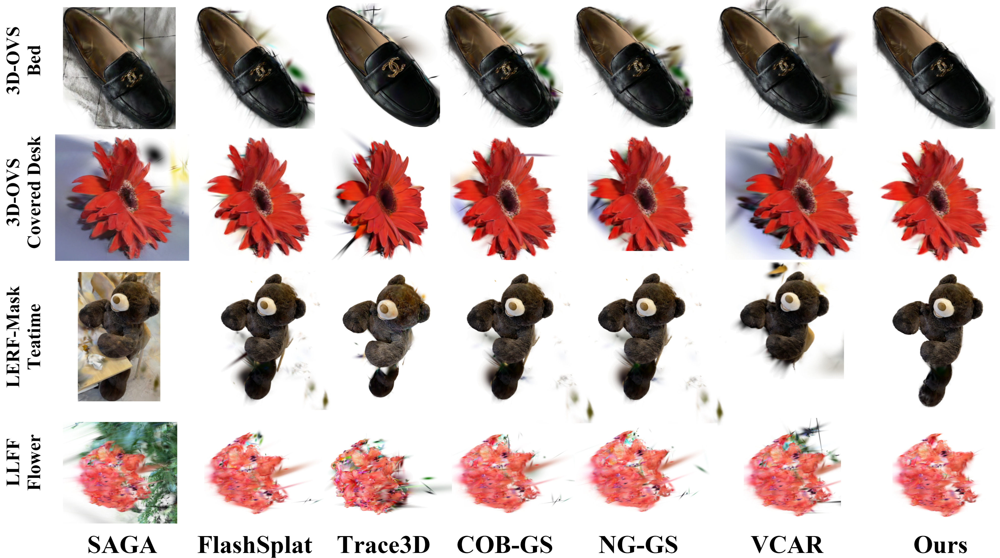
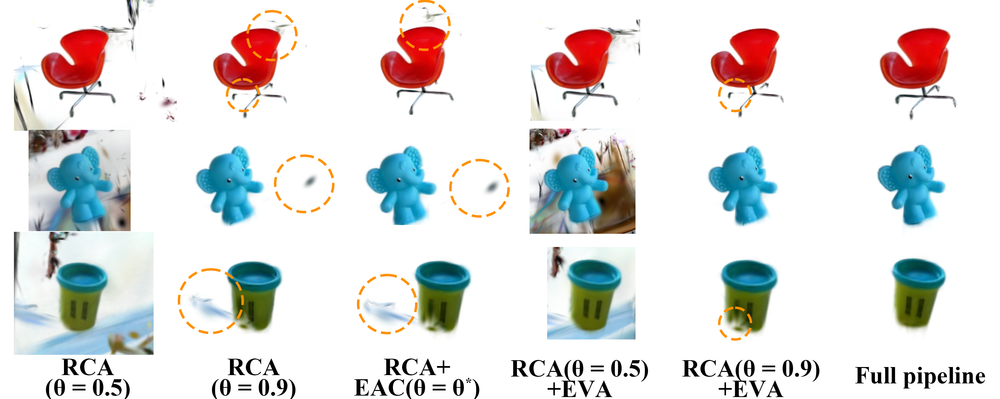
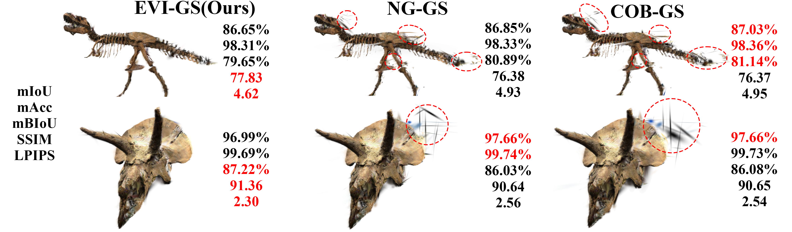

# EVI-GS

Post-reconstruction **object segmentation** on top of [3D Gaussian Splatting](https://repo-sam.inria.fr/fungraph/3d-gaussian-splatting/) (3DGS).
A trained scene is reused as a frozen geometric prior; each object is then segmented independently.

## Method (overview)

Valid stage combinations: **1**, **1+2**, or **1+2+3**.

1. **support_init** — FlashSplat-style foreground / background support; initialize per-Gaussian affiliation \(z_i\).
2. **learn_tau** (default on) — freeze Gaussians and learn a scalar export threshold \(\tau^\star\). Disabled with `--no_learn_export_tau` (export uses \(z_i \ge 0.5\)).
3. **post_tau_admission** (default on, requires learn_tau) — read-only floater cleanup after \(\tau^\star\). Disabled with `--no_post_tau_admission`.

## Figures

Figures under `assets/`. Stage names in the figures: **RCA** (rendering-contribution attribution, stage 1), **EAC** (extraction-aligned calibration, stage 2), **EVA** (evidence-validated admission, stage 3).

### Pipeline

Frozen 3DGS scene, then RCA → EAC → EVA, and the extracted object Gaussian.



### Qualitative comparison

Object cutouts on 3D-OVS, LERF-Mask, and LLFF against SAGA, FlashSplat, Trace3D, COB-GS, NG-GS, and VCAR.



### Ablation

Same objects under RCA-only thresholds, RCA+EAC, RCA+EVA, and the full pipeline. Orange circles mark missing parts or leftover floaters.



### Side-by-side with NG-GS and COB-GS

Two objects with mIoU, mAcc, mBIoU, SSIM, and LPIPS. Red circles mark residual floaters on the other methods.



### Demo


[EVI-GS.mp4](assets/EVI-GS.mp4)

## Requirements

- CUDA-capable GPU
- Conda
- A C++ compiler and a CUDA Toolkit compatible with your PyTorch CUDA build

On some newer Windows MSVC toolchains the CUDA extensions need extra compiler flags; those flags are enabled automatically on Windows.

## Installation

```shell
git clone --recursive <this-repository>
cd EVI-GS
conda env create --file environment.yml
conda activate evi_gs
pip install submodules/diff-gaussian-rasterization --no-build-isolation
pip install submodules/simple-knn --no-build-isolation
pip install submodules/fused-ssim --no-build-isolation
```

Match the CUDA Toolkit major version to the PyTorch CUDA build (for example CUDA 11.8 with a `cu118` wheel).

## Sample data

Two COLMAP scenes are bundled under `data/`:

| Scene | Path |
| --- | --- |
| bear | `data/bear` |
| truck | `data/truck` |

Layout:

```text
data/<scene>/
  images/           # RGB views (one-to-one with masks)
  object_masks/     # integer object-id masks
  sparse/0/         # COLMAP: cameras.bin, images.bin, points3D.bin
```

Scene reconstruction uses `images` + `sparse`. `object_masks` are used by EVI-GS.

## Usage

Train a scene, then run EVI-GS from that checkpoint.

```shell
# 1) RGB reconstruction
python train.py -s data/bear -m output/bear

# 2) Object segmentation (object_id is the mask class)
python train_evi.py -s data/bear -m output/evi/bear/34 --warmup_from output/bear --object_id 34

# 3) All objects in a bundled scene (requires a trained model under output/<scene>)
python tools/run_evi.py --scenes bear
python tools/run_evi.py --scenes bear,truck
```

Useful flags for `train_evi.py` / `tools/run_evi.py`:

| Flag | Effect |
| --- | --- |
| `--no_learn_export_tau` | Skip stage 2; export at $z \ge 0.5$ |
| `--no_post_tau_admission` | Skip stage 3; z-cut only |
| `--support_max_views N` | Views used for support_init (`<=0` = all fit views) |

Other utilities:

```shell
python extract_evi.py -m output/evi/bear/34 --tau 0.5
python tools/eval_evi_protocol.py --scene_out output/evi/bear --source data/bear
```

Outputs are written under `output/` (gitignored).
